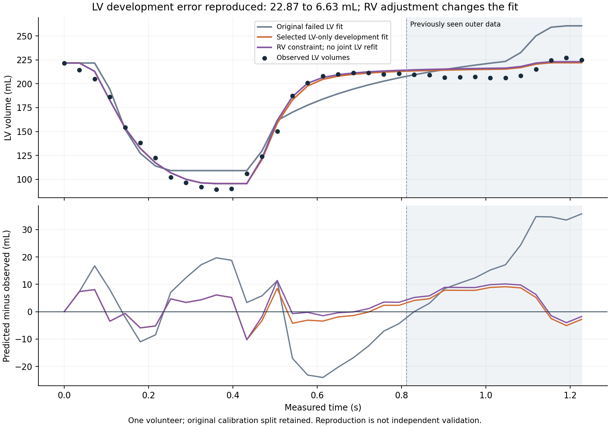

# KIT chamber-law development reassessment: reproduced evidence

All four development families were rerun successfully in the user's reconnected Edge Colab on 2026-10-21. **Every previously reported score reproduced exactly.** The LV-only selected model retains calibration RMSE **4.9104948 mL** and previously seen outer RMSE **6.6323319 mL**, compared with original **22.8685465 mL** and persistence **8.0613390 mL**.

This is one-volunteer development work using previously seen data. It is not independent or clinical validation and does not establish a fully personalized whole-heart system. The original failed benchmark and earlier session summary remain intact.

## What changed and why

HeartTwin PR #56 added opt-in exponential passive filling and asymmetric activation. Missing optional parameters preserve the original linear/symmetric behavior. New parameters have explicit units (1/mL and dimensionless); invalid values/overflow are rejected. Legacy KIT LV predictions were unchanged at stored precision.

The calibration window originally ended before assumed atrial contraction. Atrial maximum elastance could therefore have no calibration effect while affecting later predictions. The new screen rejects provably inactive chamber emax fitting using calibration axes only, before inference. It includes wrapped time-zero activation; fitted timing is conservatively excluded. This is a narrow structural screen, not proof of identifiability.

Earlier distinct integration bugs remain documented in PR #55 (native pressure/volume unit metadata) and ElectroTrace PR #85 (constant-group strict JSON and all-ties rank statistics). The native circulation benchmark is not secretly a solve by CardiFlow, CardiMech or CardiEP; registry/command transport and full-stack checks test separate contracts.

## Protocol and all four reproduced outcomes

The same 35 measured LV times were retained: 23 original calibration samples and 12 outer samples. Each family fitted the first 17 calibration samples, chose by the next six, then refitted all 23. Cross-family choice used inner RMSE, never the previously seen outer error. Model phase changes activation, not measurement timestamps. The sequential exploration and rerun remain retrospective development work.

| Family | Inner RMSE, mL | Full calibration RMSE, mL | Previously seen outer RMSE, mL |
|---|---:|---:|---:|
| Initial nonlinear + asymmetric law | 8.6614754 | 7.9505233 | 16.2620275 |
| Expanded-bound refinement, no phase | 8.3043581 | 7.3436990 | 8.7514638 |
| **Stable stiffness profile, fitted phase: selected** | **3.6349856** | **4.9104948** | **6.6323319** |
| Stable stiffness profile, fixed phase | 4.9744283 | 7.0213898 | 6.0198379 |

The fixed-phase model had better outer error but did not win the declared inner criterion. It remains in the archive.

Initial fits hit curvature bounds 0.025 and then 0.05. Profiling used k=[0.005,0.0125,0.025,0.05,0.075,0.1] 1/mL, two fixed starts and 55 evaluations per start. Stable coordinate:
`Emin=P_ref*k/expm1(k*(V_ref-V0))`, with the linear k=0 limit. V_ref=221.644518 mL is measured initial LV volume; **P_ref is a fitted conditional pressure, not a measurement**.

Selected k=0.075 lies inside the profiled grid, but activation peak fraction reaches its 0.75 bound. Zero-volume Emin is not directly comparable with old linear or clinical elastance. Full bounds, starts, singular values, termination messages, requests and predictions are preserved in the actual results.

## Numerical consistency, residuals and remaining RV mismatch

The exact selected candidate was rerun through direct, registry and command-forward routes. Both routed volume differences were zero. Separate DOP853 comparison over dense output differed by at most **0.00197356 mL**, reducing to **0.0000126614 mL** under tighter native settings. Numerical consistency is not independent patient validation.

Selected LV outer MAE=6.2204703 mL, bias=+4.4839643 mL and maximum absolute error=9.1299233 mL. The original RV assessment error remains **21.8724673 mL**. The dense minimum RV volume remains above the measured subsequent RV point; changing output sampling time within this window cannot close the discrepancy.

Global pressure rescaling by 0.5 or 2 left all volumes unchanged. Corresponding model peak LV pressures were 76.6814 and 306.7255 mmHg, illustrating that volume fitting does not identify patient pressure/contractility scale.

## RV and joint follow-up

[RV diagnosis](KIT_RV_DIAGNOSIS.md) separates numerical/routing explanations from assumed RV and pulmonary-loading sensitivity. Fitting the formerly assessed RV scalar alone can change LV behavior; the unit-resistance constraint worsened LV outer error to 7.3797448 mL.

[Joint LV/RV calibration](KIT_JOINT_LV_RV_CALIBRATION.md) explicitly consumes that RV point for calibration under three fixed loading controls. Its inner-selected joint candidate achieved LV development RMSE 6.4999204 mL and RV calibration residual -0.4649360 mL. These are a separate conditional research fit, not an independently validated RV repair or a universal replacement for the LV-only model. No global default was silently changed.

## Evidence and reproduction

Actual run source: `e6db5cc60ed95e233daeb01f53b59abbbc742d02`; chamber production code matches the PR #56 implementation. Python 3.13.16, NumPy 2.2.6, SciPy 1.16.3; all seven repository pins and environment freeze are recorded. The 186 patient/workbench tests, six lifecycle checks, runner compilation and lint passed in Colab.

Archive: `validation/kit_chamber_refinement_2026_10_21/colab_reconnected/KIT_chamber_reproduction_and_selected_RV_core.zip`, **1242304 bytes, 69 files**, SHA256 **74a295fbbf8de47991d17e000f6a5a5ebb93dc9a7b3303ddfc24c110a15c326b**. Uploaded Git blob **ddc03b0b6f15c343f67be1cbe7eb45a3121c2808** matches the Colab-computed value. It includes every chamber family, optimizer results, exact selected request/prediction, selected-candidate RV core diagnosis and figures. Additional per-call selected-RV artifact copies are excluded with hashes retained.

The original session's temporary directory was absent after reconnecting. The historical `SESSION_SUMMARY.json` is a transcription, not raw evidence; the new archive supplies an actual rerun record. Its prediction SHA256 is **1e8f56a584226195f1d344396a670259bdf4f58bb3bada5b5acf683c76c409a0**. Embedded paths differ between sessions; exact numerical scores reproduced.

Both notebook recipes' code cells compiled in Colab. Their numerical commands ran via the recorded scripts/driver. The final consolidated RV/LV recipe is not claimed to have been replayed end to end after consolidation. Use `HeartTwin_KIT_RV_Diagnosis.ipynb` for the full reproduction and joint follow-up; the earlier chamber-only notebook remains available.

KIT v1.1: <https://zenodo.org/records/10526554>, Gerach, Schuler, Wachter and Loewe, CC BY-NC 4.0. No source geometry is redistributed in the new archives. Same-acquisition samples are correlated; the standalone research split is not a passed strict PatientCase independent-source gate.

Clinical accuracy, independent RV prediction, absolute pressures, spatial mechanics/reference-state qualification and EDGAR electrical validation remain unestablished.
