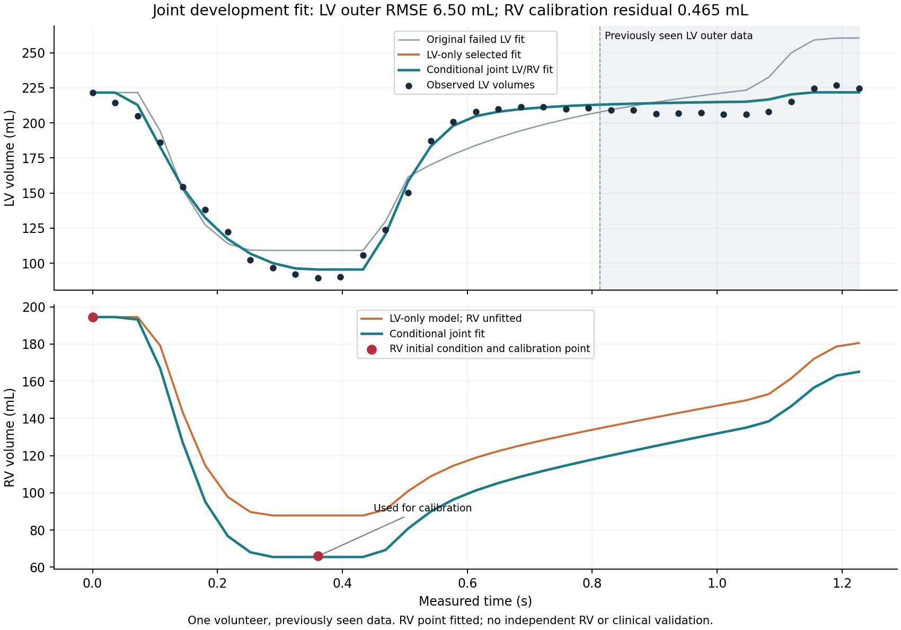

# Conditional joint LV/RV calibration: KIT development result

The standalone joint research fit now uses the original 23 LV calibration samples and the one subsequent RV volume point together. Among three predeclared RV outflow-loading controls, the candidate selected by six inner LV samples achieved **LV outer development RMSE 6.4999204 mL**, **LV calibration RMSE 4.8247964 mL**, and **RV calibration residual -0.4649360 mL**.

**The RV point was consumed for fitting. It is no longer a held-out target in this experiment.** Its small residual is not independent RV validation. One volunteer, previously seen outer data, unknown measurement-noise model and unidentified pressure scale remain. This is a conditional joint candidate, not a fully personalized or clinically qualified whole-heart system.

## Why joint fitting was added

The reproduced LV-only model gave LV outer development RMSE 6.6323319 mL and RV assessment error 21.8724673 mL. Solver refinement and both real routing paths did not explain the RV discrepancy. Matching the RV point by changing RV strength alone altered LV filling; in the unit outflow-resistance control it raised LV outer development RMSE to 7.3797448 mL.

Joint calibration addresses that coupling directly. It does not fix missing RV waveform or pressure/flow measurements, identify true pulmonary loading, or remove the pressure-scale ambiguity.

## Declared protocol

Runner: `scripts/fit_kit_joint_lv_rv.py`. Exact executed source Git blob: **7be79c8a7796b01d93b044dae82f972261a2fc6e**, checked against the source file in Colab before publication.

The runner uses SciPy least squares and HeartTwin's native circulation. It is a standalone research calibration, not a claim that the strict PatientCase source-partition gate passed. LV calibration and outer samples share one acquisition; prior outer values were already seen. The CardiInfer synthetic inverse/replay path is covered separately by the patient regression suite.

For each of RV outflow resistance factors [0.5, 1.0, 2.0]:

- Fit the first 17 LV calibration samples plus the subsequent RV point, using two fixed starts.
- Score the next six LV calibration samples. Choose the loading family by that inner LV RMSE only.
- Refit all 23 LV samples plus the RV point for every loading control.
- Freeze every complete request and prediction before opening archived LV outer values for development scoring.

Seven fitted coordinates: LV maximum elastance, LV activation duration, mitral resistance, conditional LV passive pressure at the measured initial LV volume, LV activation peak fraction, LV phase and RV maximum elastance. The previously selected passive curvature k=0.075 1/mL stays fixed; no fresh curvature search uses outer scores. Other vascular, atrial, unloaded-volume and reference-state assumptions remain fixed.

The objective is unweighted LV and RV volume SSE in mL. It is not a validated measurement-noise likelihood. The first RV point remains a measured initial condition. Bounds, starts, termination criteria, source-candidate hash and all trials are in the archived protocol/results. No measured timestamp is shifted.

## All loading controls

| RV outflow factor | Inner LV RMSE, mL | Full LV calibration RMSE, mL | RV calibration residual, mL | Previously seen LV outer RMSE, mL |
|---|---:|---:|---:|---:|
| 0.5 | 4.0630955 | 4.8091402 | -0.4508505 | 6.4374120 |
| 1.0 | 4.0336207 | 4.8148756 | -0.4540072 | 6.4584922 |
| **2.0, selected within joint experiment** | **3.9290293** | **4.8247964** | **-0.4649360** | **6.4999204** |

The 0.5 control has the lowest outer score but was not selected. All inner/full optimization trials converged. The selected peak fraction again reaches its 0.75 upper bound; this remains an important model-shape limitation.

The original LV-only family had lower inner LV error (3.6349856 mL) than any joint family. Therefore the joint candidate is not declared the universal winner of the earlier LV-only comparison. It answers a different development task by conditioning on RV as well as LV data. Both complete models and every control remain available, and neither silently replaces global defaults.

The selected joint RV maximum elastance is 0.7723937520 mmHg/mL **conditional on the fixed loading/reference assumptions**. Do not interpret it as independently identified patient contractility.

## Numerical and integration checks

Actual user Edge Colab, Python 3.13.16:

- 186 patient/workbench tests passed; six lifecycle checks passed.
- Both research runners compiled and passed Ruff. An initial formatting lint error in the new joint runner was fixed before any fit; its failed source/log are retained.
- Exact measured RV target appears in diagnostic output.
- Registry and command-forward volume differences versus direct execution: **0 mL**.
- Joint native versus separate DOP853: maximum dense volume difference **0.00358330 mL**.
- Tight native versus DOP853: maximum **0.0000142603 mL**; RV target difference **-0.00000132061 mL**.
- Joint total-volume drift **2.73e-12 mL**.

The numerical thresholds are diagnostic tolerances, not clinical limits. The independent solver is an implementation consistency check, not independent patient validation. The research runner is not a substitute for spatial mechanics, ECG or broader physiological validation.

## Evidence

`validation/kit_joint_lv_rv_2026_10_21/` contains the three complete frozen joint candidates, all optimizer trials, protocol, verification, figures, CSV, source helpers, failure record, notebook compile results and archive.

Core ZIP: **465525 bytes**, **41 files**, SHA256 **9311dadf37d5880f44b9c32c9bc6c215d05a2fee22ff8160173982fb566b5572**. Git blob **e641ae55bea2e742ff41c235792bd63b567b138e** matches the Colab-computed value. It contains the full joint calibration candidates and canonical verification output; additional per-call verification artifact copies are excluded and their hashes retained.

The consolidated `HeartTwin_KIT_RV_Diagnosis.ipynb` pins all seven source repositories and the observed dependency versions. Its seven code cells and the chamber notebook's six code cells compiled in Colab. The constituent numerical steps ran in this session; the final consolidated file is not claimed to have been replayed end to end after consolidation. Each replay uses a unique output folder to preserve older runs.

KIT v1.1: <https://zenodo.org/records/10526554>, Gerach, Schuler, Wachter and Loewe, CC BY-NC 4.0. Same volunteer/acquisition; derived volume data do not establish clinical accuracy or permit blanket commercial use. No source geometry is redistributed in these new archives.

## What remains

Independent RV temporal measurements and pressure/flow information are needed to assess predictive RV accuracy and constrain loading/pressure. LV residual structure and the activation-shape bound remain. EDGAR waveform/coordinate/topology issues, scalable spatial mechanics and reference-state qualification remain separate unfinished work. The completed work is reproducible conditional calibration and diagnosis, not clinical qualification.
