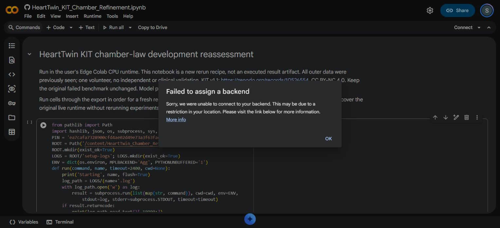

# Sparse KIT RV diagnosis: pending Colab execution

## Confirmed source findings

The original RV assessment compares the model at 0.360882353 s with 65.938406 mL. The only other measured RV volume is 194.545622 mL at time zero, used as an initial condition. There is no RV waveform in this benchmark. Both measurements and timestamps remain unchanged.

The original fit optimized LV maximum elastance, LV activation duration and mitral resistance against LV calibration values only. RV maximum elastance (0.5 mmHg/mL), minimum elastance (0.03 mmHg/mL), activation duration (0.5 s), activation start (0 s), pulmonary loading and other initial states were analyst assumptions. Therefore LV error reduction is not evidence that RV parameters were personalized. The reported original RV error was 21.8719913 mL; the subsequent selected LV candidate retained approximately the same RV error.

One subsequent scalar RV value cannot identify several independent RV and loading parameters. Any fit to that already seen assessment point is a retrospective development constraint and consumes that point for fitting. It cannot be reported as held-out validation. Absolute pressure scale also remains unidentified by volumes.

These source findings identify a gap in personalization, but do not by themselves prove that a particular assumed parameter caused the numerical discrepancy.

## Diagnostic runner

`scripts/diagnose_kit_rv.py` accepts an immutable request and the original benchmark folder. It:

1. Checks the two RV measurements, units, initial-condition agreement and time support. Adds the exact target time and dense output samples without shifting measured timestamps.
2. Compares native RK45 trajectories with a separate incidence-matrix DOP853 implementation using cosine activation and exprel passive pressure, including the new chamber laws.
3. Exercises the real registry and command-forward routes and checks their outputs against direct execution. A mismatch halts physiological attribution.
4. Perturbs six assumed RV/loading coordinates by ±20%, recording RV endpoint and LV trajectory effects and preserving any failed perturbation.
5. Optionally fits RV strength at three fixed outflow resistances to the previously seen scalar. All candidate requests and predictions are separate development artifacts. A missing root bracket or failed solve is retained.
6. Records source hashes, environment, conservation and status. The original request is never replaced.

The 0.02 mL numerical solver comparison threshold and 1e-8 mL routing threshold are software diagnostic criteria, not clinical acceptance limits. Multiple numerical solutions, if found, demonstrate conditional ambiguity; they are not identified patient parameters. This runner does not perform a spatial mechanics or electrical solve, and does not silently replace HeartTwin's native 0D engine with another repository.

## Current execution blocker, 2026-10-21

Edge reconnected successfully. Its open-tab inventory no longer included the original Colab tab. Colab's Manage sessions dialog reported **No active sessions**. Original temporary runtime files could not be inspected or recovered from an active session.

The pinned chamber rerun notebook was opened in the user's Edge. Two normal runtime-allocation attempts were rejected with **Failed to assign a backend**, with a message suggesting a possible location restriction. The exact cause is not established. The setup cell never executed. Browser automation also timed out during a subsequent page read; the later visible dialog and screenshot confirmed the allocation rejection.

No RV numerical results, new full lifecycle result, new independent-solver pass, or regenerated chamber bundle are claimed. The runner and its new notebook remain **unexecuted in Colab**. Keep this PR as a draft until execution and review of its retained results.

## Next executable steps

Once the user's Edge Colab can allocate a runtime, run `notebooks/HeartTwin_KIT_RV_Diagnosis.ipynb` against the original fitted request first. The notebook pins all seven repositories, saves software checks and exports hashes and a ZIP.

To diagnose the improved LV candidate, regenerate the chamber results using `HeartTwin_KIT_Chamber_Refinement.ipynb`, then explicitly point the RV runner at its `selected_request.json`. Do not silently substitute a partial reconstructed request; the summary contains insufficient parameters for exact replay.

If numerical/routing checks pass, inspect sensitivity and optional conditional solutions before proposing a parameter or model change. Obtain independent RV time-series or pressure/flow information for genuine personalization and subsequent validation. Keep the original benchmark, selected LV candidate and all negative results intact.
