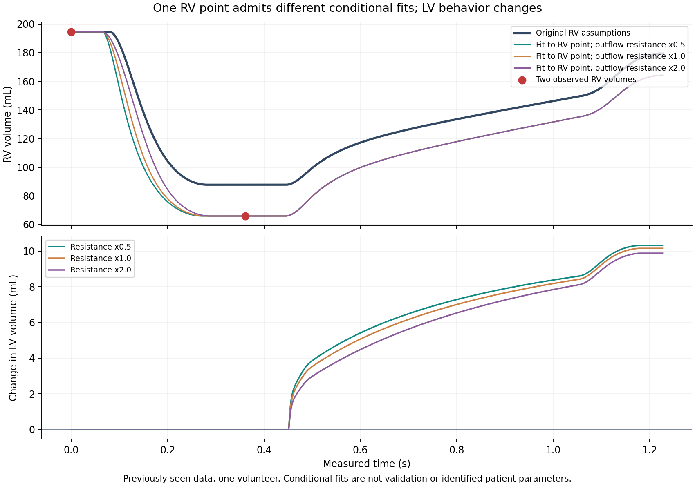

# KIT RV diagnosis: actual reconnected Colab results

Edge Colab successfully allocated a runtime on retry, 2026-10-21. The prepared diagnostic has now run. **The original 21.8719913 mL RV mismatch is not explained by numerical tolerance, time sampling or either tested HeartTwin transport route. RV and pulmonary-loading assumptions strongly affect the result, but the sparse data do not identify a unique correction.**

Implementation pin: `e6db5cc60ed95e233daeb01f53b59abbbc742d02`. Python 3.13.16, NumPy 2.2.6 and SciPy 1.16.3; all seven repository pins and package freeze are archived. **186 patient/workbench tests, all six lifecycle checks, runner compilation and lint passed in user Edge Colab.** These are software/synthetic checks, not clinical validation.

## Tests and findings

| Check | Observed result | Implication |
|---|---:|---|
| RV target sampled at exact measured time | Yes, 0.360882353 s | Interpolation or a shifted measurement clock does not explain this comparison |
| Original RV prediction versus observed | 87.8103973 versus 65.938406 mL | Original error remains 21.8719913 mL |
| Minimum RV volume over dense output | 87.8103579 mL | No sampling time within this simulated window reaches the observed volume |
| Registry versus direct route | 0 mL maximum difference | No numerical mutation in this tested route |
| Command-forward versus direct route | 0 mL maximum difference | No numerical mutation in this tested route |
| Native versus separate DOP853, all dense volumes | 0.0101175 mL maximum, in LV at 0.452884 s | Small tolerance-dependent error, unrelated in scale to the RV discrepancy |
| Native versus DOP853 at RV target | -0.00016024 mL | Negligible relative to the RV mismatch |
| Tight native versus DOP853, all dense volumes | 0.000009361 mL maximum | Tolerance refinement explains the small dense-output discrepancy |
| Tight native versus DOP853 at RV target | -0.000006110 mL | Numerical convergence supported |
| Total-volume drift | 2.27e-12 mL | Conservation check passed |

The numerical thresholds (0.02 mL reference comparison; 1e-8 mL routing comparisons) were diagnostic criteria declared in the runner before this run. They are not clinical acceptance limits. The separate reference uses an incidence matrix, cosine activation, exprel passive pressure and DOP853. The native reference discrepancy was investigated rather than dismissed after passing its threshold.

These tests isolate this particular native 0D benchmark. They do not prove every engine in the stack is correct. CardiFlow, CardiMech and CardiEP are not secretly the numerical source of this native circulation solve. The earlier ElectroTrace constant-group statistics bugs were separate real cross-repository defects, fixed in PR #85; the earlier native unit-metadata defect was fixed in HeartTwin PR #55.

## Why a unique RV repair cannot be claimed

The source provides only RV volume 194.545622 mL at time zero and 65.938406 mL at the subsequent time. The first is an initial condition; only one subsequent scalar is available. The original fit optimized LV strength, LV duration and mitral resistance against LV measurements. RV strength/timing and pulmonary loading remained assumed.

Sensitivity to ±20% changes was substantial:

| Assumed coordinate | RV endpoint change at -20% | RV endpoint change at +20% |
|---|---:|---:|
| RV maximum elastance | +14.4611 mL | -10.6347 mL |
| RV activation duration | +3.1441 mL | -2.7957 mL |
| RV minimum elastance | +0.1680 mL | -0.0570 mL |
| Pulmonary vascular resistance | -2.9909 mL | +2.1730 mL |
| RV outflow resistance | -0.3392 mL | +0.3799 mL |
| Pulmonary arterial compliance | +8.8720 mL | -7.4227 mL |

Three distinct conditional strength/loading combinations were fitted to the **previously seen RV assessment point**, explicitly consuming it for development fitting:

| RV outflow resistance factor | Conditional RV Emax, mmHg/mL | Fitted RV volume, mL | Maximum LV trajectory change, mL |
|---|---:|---:|---:|
| 0.5 | 0.7382893941 | 65.93840598 | 10.3120 |
| 1.0 | 0.7457058835 | 65.93840599 | 10.1515 |
| 2.0 | 0.7651195543 | 65.93840597 | 9.8782 |

These fits show that the scalar can be matched in more than one way. **They are not held-out validation or uniquely identified patient parameters.** Their inferred RV peak pressures also differ and are not measured patient pressures. Global pressure scale remains unidentified by volume alone.

Changing RV parameters changes LV filling through the closed loop. Therefore an isolated RV patch cannot preserve a previously fitted LV trajectory automatically; joint calibration and subsequent assessment are needed. Each conditional request/prediction is saved separately. The original request remains unchanged and the failed benchmark is retained.

## Evidence and reproduction

Evidence: `validation/kit_rv_diagnosis_2026_10_21/colab_reconnected/`.

The first core ZIP contains 61 files, 652339 bytes, SHA256 **138218ac575fe01e9f2d275b6e4bf82c9420734254a18c116439c04762b47b93**. Its Git blob **331bed463f9ad9c5de2fbf0e9a60c88fae983b21** matches the value independently computed in Colab before upload. It includes requests, predictions, protocol, logs, test XML and environment. Forty-nine native artifact copies from individual calls are excluded from the core ZIP, with their hashes retained separately. Tolerance refinement, plot source and figures were added after that checkpoint and are supplied separately.

Run `notebooks/HeartTwin_KIT_RV_Diagnosis.ipynb` in Edge Colab. The runner accepts the original request or an explicitly supplied complete candidate request, never a partially reconstructed summary. Optional constraint fitting is marked as development fitting and never overwrites the source request.

Four earlier chamber families are being regenerated separately to restore the missing raw LV evidence. The original session's temporary directory was absent in the new runtime. A rerun is a new reproducibility record, not recovery of those lost files and not an unseen-data validation experiment.

## Earlier failures and their resolution

Before this retry, Edge had reconnected but Colab reported no active sessions and rejected two runtime allocations with “Failed to assign a backend,” suggesting a possible location restriction without establishing its cause. The actual screenshot is retained. On this retry allocation succeeded; no workaround or security setting change was applied by the agent.

Colab also misparsed the slash-containing branch name as ref `diagnose`, producing a misleading Notebook not found error. The immutable commit URL loaded successfully. A branch-publication API error was corrected by creating the branch before opening the PR. These execution errors and their diagnoses are preserved in `EXECUTION_ATTEMPTS.json`; none were numerical model errors.

## Remaining limits

One volunteer, previously seen data, no clinical qualification, no independent patient validation, no identified absolute pressure scale, no measured RV waveform or independent pressure/flow series, no steady-state claim, no spatial mechanics or EDGAR electrical validation. The current diagnosis narrows the RV discrepancy to conditional model/input assumptions after the tested numerical and routing explanations were eliminated; it does not establish a unique physiological cause.
